# Daily Bank Reconciliation r3: old-screen guard, pending amounts per day, posted-entry verification — test-stage report (12 Oct 2026)

**Scope of this stage**

- Everything in this stage ran on the **isolated test instance** only (`http://localhost/avenir_rv/`, database `avenir_restore_verify_20261011`), after being built and tested in my cloud workspace.
- **Development is still on r1**: its files, its reconciliation tables (empty, schema version 1) and its ledger are unchanged. **Live was not touched.**
- Only dummy data and TEST logins were used. No real bank account was entered, no real statement was imported, no real accounting entry was changed. The one dummy posting was written into the isolated test database only.
- No backup was deleted. D1–D7 and E1–E7 stay open; no rate policy, first day, mapping or role was assumed.
- **I have stopped here.** Nothing goes to development or live without your approval.

---

## 1. Results at a glance

| Where | What ran | Result |
|---|---|---|
| **Isolated test instance (your computer)** | r3 verification in two browser sessions, with TEST logins | **38 / 38** browser checks (32 new-feature + 6 safeguards re-checked) |
| | Database checks, before/after ledger checks, tested rollback | **16 / 16** |
| | Two **different** users at the same instant (2 races) | **2 / 2**: one accepted, one refused (409), requests overlapped |
| | Sign-out fix (separate request), installed then rolled back | Before: problem reproduced, page blanked (5 / 5 checks); after: **6 / 6** (one browser-cache finding, §7) |
| **Cloud test copy only** | Regression battery | 202 / 71 / 36 / 33 / 26 / 10 — **all pass** |
| | r2 suite on the r3 code; r2 screens | **108 / 108**; **20 / 20** |
| | r3 suite (r2 parts again + r3, true parallel races) | **132 / 132** |
| | r3 screens | **24 / 24** (first run 22 / 24: my test looked for correction "#12" by number; fixed the test, not the code) |
| | Rehearsal of the instance run (instance data rebuilt 63 / 63, the same r3 script and SQL steps, the reset compared table by table) | **34 / 34** (two earlier runs failed only on test set-up — the activity log not excluded from the table comparison; a race started before both test sign-ins had finished — fixed in the test) |
| | Sign-out fix: before / after | 14 / 14 problems reproduced; **18 / 18** after |
| **Real ledger** | All rows outside the dummy range, with their reconciliation flags | **Unchanged** on the instance and on development (§4) |

---

## 2. What r3 changes (kit `tf-bankrec-r3`)

| # | Change | What it does now |
|---|---|---|
| **1** | **D7 guard on the old screen** (Accounts → Bank Reconciliation, `accounts/bank_reconcil`) | **Refuses** any change for a bank ledger account that has a **confirmed** mapping, for rows dated **on or after** that mapping's first day: ticking/unticking a row, "Finalize selected", "reconcile up to", moving rows to or from the unrealised account (post, repost, repost single).  **Earlier dates** stay available exactly as before.  **A refusal** changes nothing, shows the reason on the screen ("…from 2026-09-01 this account is reconciled in Accounts → Daily Bank Reconciliation. Dates before 2026-09-01 can still be reconciled here. Nothing was changed.") and is audited (`brc_legacy_refused`).  **Existing old-screen flags** in a protected period (`bank_rec`, `bankst_flag`, rows moved to the unrealised account 1-6-112-10782) are **listed as a warning** on the day and on the overview — **never cleared or changed**. |
| **2** | **Pending corrections per day** | A correction covering several days is counted on a day **only for the part attributable up to that day**; its **full total is named separately**: "1 approved but not posted (**25.00 up to this day; correction total 4,550.00**)" plus "#1: 25.00 of 4,550.00 falls up to this day". Each correction is counted once. Status and "ledger not yet corrected" work as before. Daily records keep this wording in their snapshot. |
| **3** | **Verify again** | A posted correction whose ledger entry changes afterwards reads **"Posted entry changed in the ledger — verify again"** and counts as not corrected. The preparer can verify it again: accepted only if the entry still matches the approved lines exactly; refused (409) with the differences otherwise. Both outcomes are audited. |
| + | Two small fixes found while testing | The old screen's error messages now appear at all (its `swal()` calls throw with the SweetAlert2 11 the page loads, so even "Something went wrong" never showed). Corrections and opening items withdrawn by their proposer read "**withdrawn by** …" instead of looking reviewed. |

**Files:** 8 changed (Routes.php +1 route; DailyBankRecController; the old screen's controller and view; Rec; Corrections; account and index views) and 1 added (`LegacyGuard.php`). **No database change** (schema stays at version 2). Nothing writes to the ledger or its flags.

**Which accounts are protected and from when depends only on confirmed mappings.** On development and live there are none yet (D3, D4 open), so the guard protects nothing there until you confirm mappings.

---

## 3. Local tests — isolated test instance on your computer (12 Oct, about 11:20–11:52 Sri Lanka time)

**Logins:** TestAccounts (prepares; also has the old screen), TestFinApprover (reviews), TestBankAuth (view only), TestHotelRes and TestOperations (no access), and **TestRecDual** — a new TEST login in a new TEST group holding view + prepare + review of Daily Bank Reconciliation only (not an administrator). TestRecDual exists only for this test; the reset removes it. It is not a role decision.

**Sessions:** one tab on `localhost`, one on `127.0.0.1` (separate sign-ins).

| Area | Checked on the instance | Result |
|---|---|---|
| **D7 — old screen** | Refused (409, reason given): ticking 2 Sep dummy row 99980305; "Finalize selected" mixing a 28 Aug and a 3 Sep row; "reconcile up to" 5 Sep; moving a row to the unrealised account; moving one back; reposting a range reaching 1 Sep; a TEST LKR account row. **Allowed:** ticking and unticking the 28 Aug cheque row; "reconcile up to" 31 Aug. On screen: the refusal message, row not marked; the 28 Aug row turns green as before. | **All pass.** Every dummy row's flags identical before and after; 8 refusals audited, all by TestAccounts |
| **D7 — warning, flags left alone** | Old-screen flags simulated on two dummy rows (bank_rec on 99980306; 99980307 moved to the unrealised account). The new workflow lists both on the day and shows "Old-screen flags in the period: 2" on the overview. The flags were still set afterwards; then put back by me. | **All pass** |
| **Pending amounts per day** | TEST LKR, approved but not posted: **1 Sep 25.00 · 2 Sep 50.00 · 3 Sep 1,050.00 · 4 Sep 236,050.00 (total 239,550.00) · 5 Sep 239,550.00** · 6 Sep 239,575.00 · 7–8 Sep 339,575.00. The 4,550.00 charges correction grows 25 → 50 → 1,050 → 4,550 and is counted once. A record prepared for 1 Sep and reviewed keeps "25.00 up to this day; correction total 4,550.00".  **Before r3** (same data, after the rollback): 1 Sep showed the whole 4,550.00. | **All pass** |
| **Posted dummy correction** | Dummy entry **99980399** written into the test database (Dr Bank Charges 4-8-37-10818 25.00 / Cr TEST verification bank 1-6-8-29904 25.00, 1 Sep) and recorded as the posting of correction 6 → **posted and verified, linked to 99980399**; 5 Sep no longer pending. | **Pass** |
| **Change → verify again** | Wording changed → "verify again"; the reviewer cannot verify again (403); the preparer can → verified again (audited); again with nothing changed → refused (409). Amounts changed 25 → 30 → refused with the differences (409, audited), stays "verify again". Amounts back → verified; wording back → "verify again" → verified. | **All pass** |
| **Same person, both privileges** | TestRecDual: proposes an opening item (200) but cannot accept it (403); proposes a correction (200) but cannot approve it (403); prepares a record (200) but cannot review it (403) — on screen there is no Review button, and forcing it shows "must be reviewed by someone other than the person who prepared it". May review someone else's record (200). | **All pass** |
| **Two different users at once** | TestAccounts (localhost) and TestRecDual (127.0.0.1) classify the same statement line at the same instant → **200 / 409** "already classified". TestFinApprover and TestRecDual review the same record → **200 / 409** "not waiting for review"; one audit row. Both pairs overlapped in the server. | **All pass** |
| **Safeguards after r3** | **Opening items:** 1–5 Sep explained each day; cheque 000202 outstanding throughout; 000201 cleared from 3 Sep. **Partial clearing + undo:** undoing the completion re-activates the partial match (rest −40,000.00); completing it again works; the reviewed 3 Sep record unchanged. **Changes after review:** dummy row edited → "Changed since review — re-review needed: ledger rows"; put back → current. **Exchange-rate explanations:** USD 5 Sep has none unexplained; record current. **Pending vs posted:** LKR 8 Sep "4 approved but not posted (339,575.00)"; verification account none pending. **Permissions:** other departments 403; view-only cannot verify again. | **6 / 6** |

---

## 4. Before / after checks of the real ledger

Signature of every `account_runing` row **outside** the dummy range 99980000–99999999: row count | total Dr | total Cr | checksum over ID, ledger code, amounts, description, date, `aflag`, **`bank_rec`, `bankst_flag`**, `BankFlg`, receipt and cheque numbers.

| When | Isolated instance | Development |
|---|---|---|
| Before r3 | `11364 | 965763907.13 | 965314763.93 | 24383521306171` | `11364 | 965763907.13 | 965314763.93 | 24383521306171` |
| After all tests, after the rollback and after r3 was put back | **identical** | **identical** |

Development also still has: r1 files (md5 checked), schema version 1, empty reconciliation tables, no rows in the dummy range, no TestRecDual. The dummy posting 99980399 used the real Bank Charges ledger code in the **test database only**, and was removed by the reset.

---

## 5. Backups and the tested rollback

**Backups taken before any change (all on your computer):**

1. **Files:** `C:\wamp64\www\avenir_rv-backup-20261012-before-r3\` — the instance's `app\` and `public\` (1,725 files) with an md5 list.
2. **Whole database:** copied to the new database **`avenir_rv_backup_20261012_before_r3`** (241 tables, 165 MB). Every table's checksum equals the original's. Views, triggers and routines were not copied (r3 does not touch them).
3. **Reconciliation test data:** 17 parts in `C:\wamp64\tmp\brc_r3_backup_20261012\` = the kit's `sql/before-r3-snapshot/` (md5 listed).
4. The kit's own backup of the 8 replaced files: `tf-bankrec-r3\before\20261012-055949\`.

**Rollback tested on the instance:**

- `python apply.py rollback` put the 8 r2 files back. `LegacyGuard.php` was **moved** into the kit's backup folder, because deleting is not allowed there. Afterwards **all 1,725 files** were identical to the file backup.
- `sql/reset-to-before-r3.sql` (guarded: this database, schema 2) put the test data back. Afterwards **every table** had its pre-r3 checksum, except four that only grow: the audit trail, the activity log `a_log` and the two session tables. TestRecDual and its group were gone, and the ledger signature was unchanged.
- **r2 behaviour returned:** LKR 1 Sep counted the whole 4,550.00 again; the "verify again" route answered 404; and the old screen ticked a 2 Sep dummy row again (I ticked it, then unticked it).
- **Then I put r3 back** (`before\20261012-061644`). It is installed now, for your review, on the pre-r3 data: no TestRecDual and no dummy posting.

**Cloud rehearsal of the same run (34 / 34):** `results/cloud/rehearsal_rv_r3.log` — it rebuilds the instance's data, runs the same script and SQL steps, applies the kit's reset and compares every table. The install/rollback script was also rehearsed on a copy (`results/cloud/apply_rehearsal.txt`): apply, rollback with deleting refused, rollback with deleting allowed, refusal of the development base URL, refusal of a file that is not the r2 file.

---

## 6. Screenshots

**Isolated instance (your computer):**

- `r3_00_…` before r3 (after the rollback): LKR 1 Sep counts the whole 4,550.00
- `r3_00b_…` before r3: the old screen ticks a 2 Sep row of a mapped account
- `r3_01_…` / `r3_02_…` the warning about old-screen flags, on the day and on the overview
- `r3_03_…` / `r3_04_…` pending amounts up to 1 Sep and 4 Sep, with the correction total
- `r3_05_…` – `r3_08_…` posted dummy correction verified and linked; changed → verify again; verified again; refused after the amount changed
- `r3_09_…` – `r3_11_…` the dual-role user: no Review button; refusal; "withdrawn by"
- `r3_12_…` – `r3_14_…` the old screen with r3: refusal message; an earlier date still allowed
- `sess_01_…` the sign-out fix's "Your session has ended" notice

**Cloud test copy:** `cloud_34_…` – `cloud_45_…`, the same screens on the cloud data.

### The pictures (isolated instance)

**Before r3 (r2, after the rollback): TEST LKR on 1 Sep counts the whole 4,550.00 correction.**

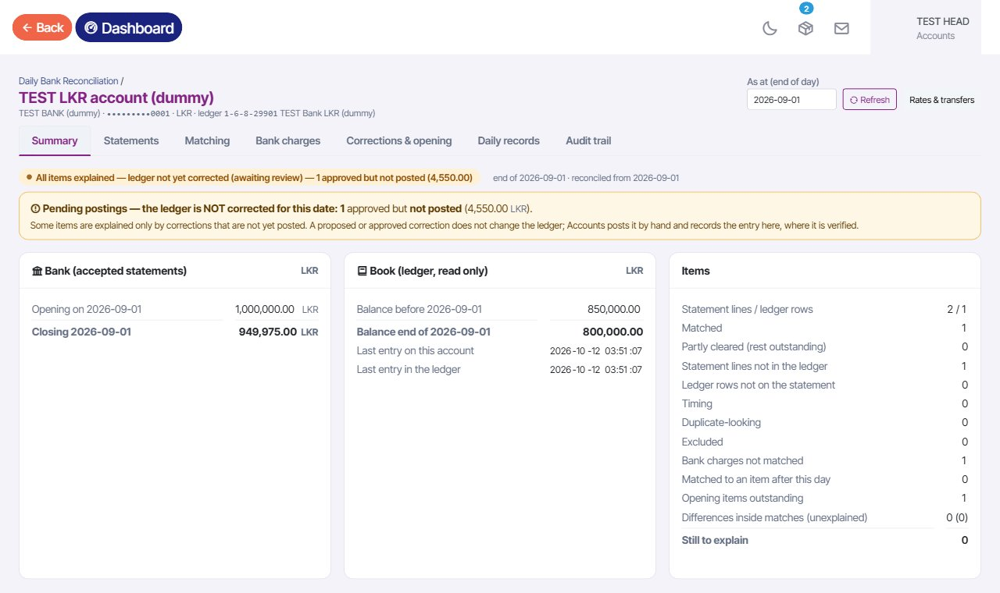

**r3: 1 Sep counts 25.00 up to this day; the correction total 4,550.00 is named separately.**

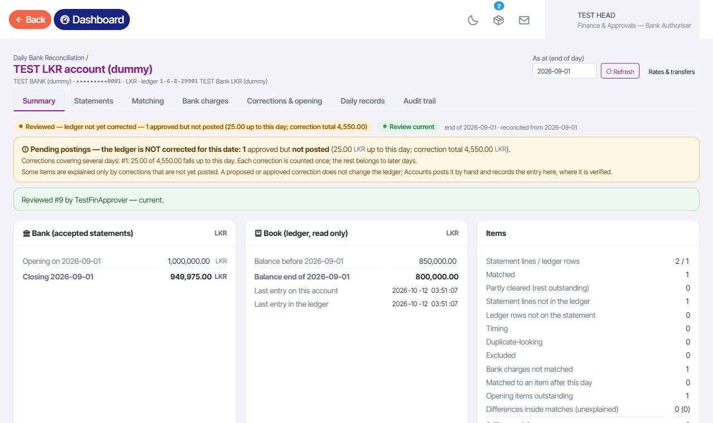

**r3: 4 Sep — 236,050.00 up to this day; correction total 239,550.00.**

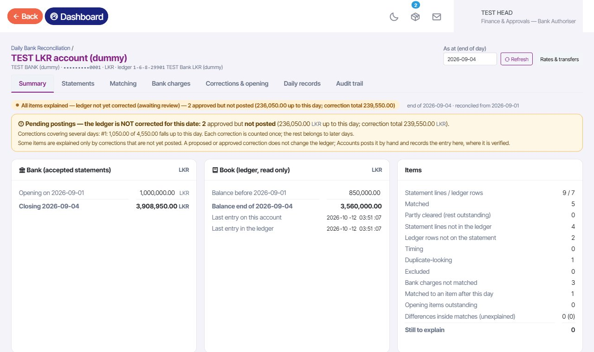

**Before r3: the old screen ticks a 2 Sep row of a mapped account (row green) — the overlap D7 prevents (unticked again).**

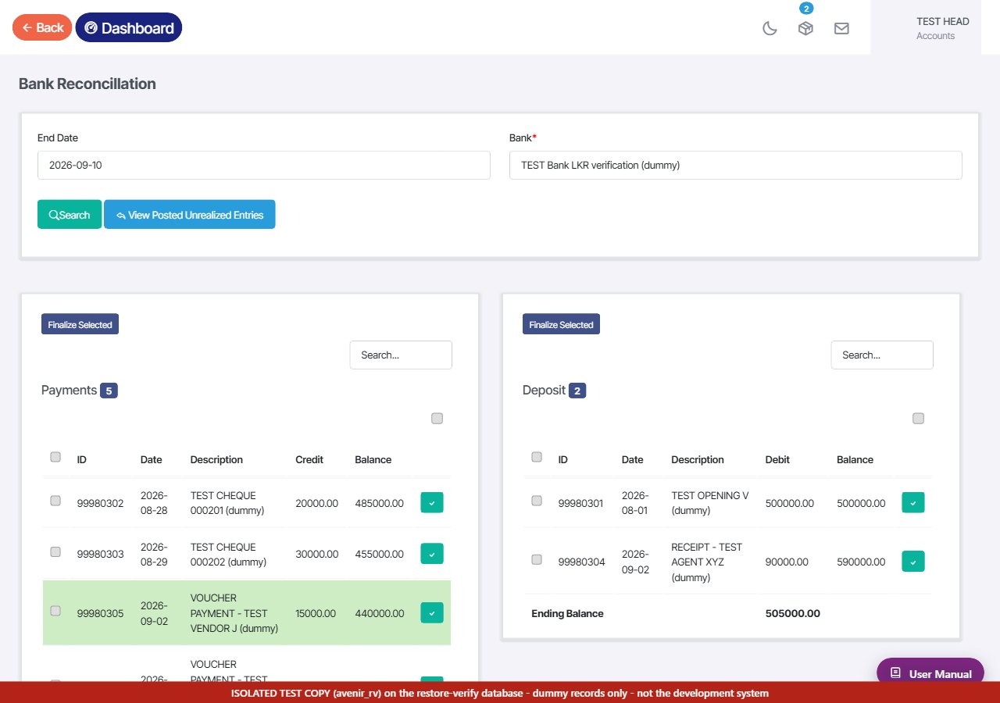

**r3: the old screen refuses the same row and says why; nothing changed.**

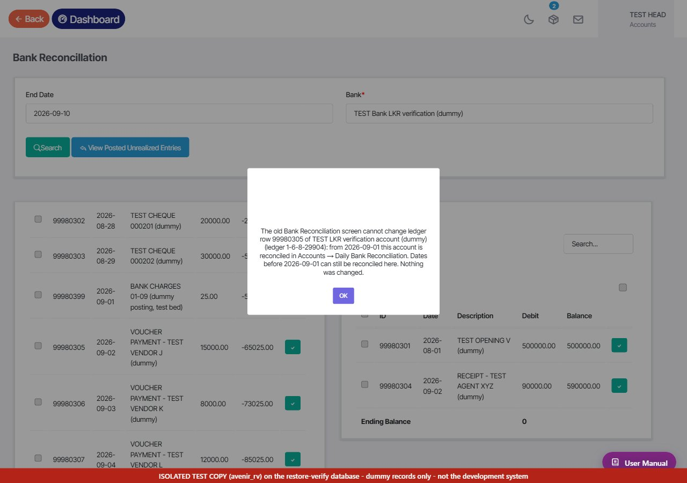

**r3: a 28 Aug row (before the first day) can still be ticked on the old screen.**

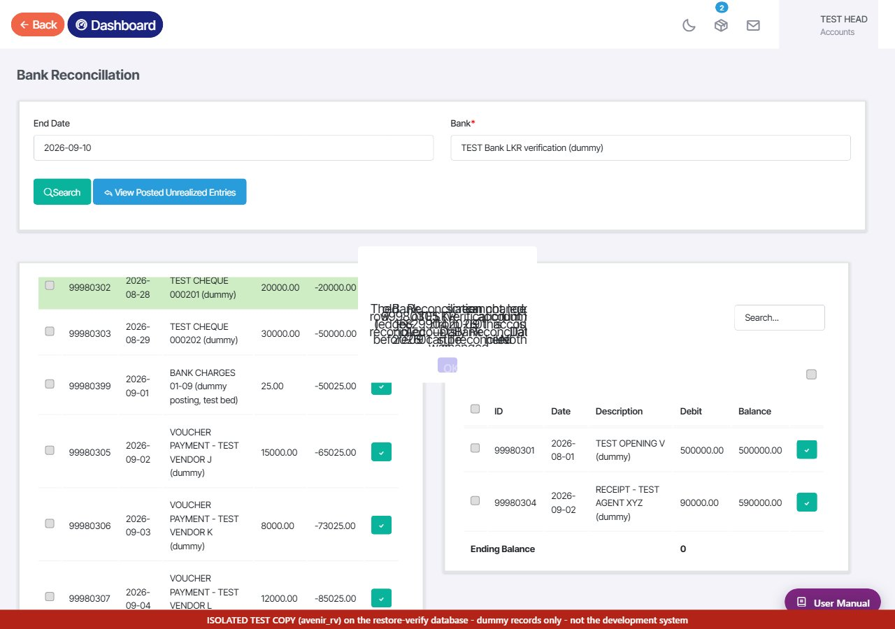

**r3: the new workflow warns about old-screen flags in the protected period (simulated on two dummy rows) and leaves them.**

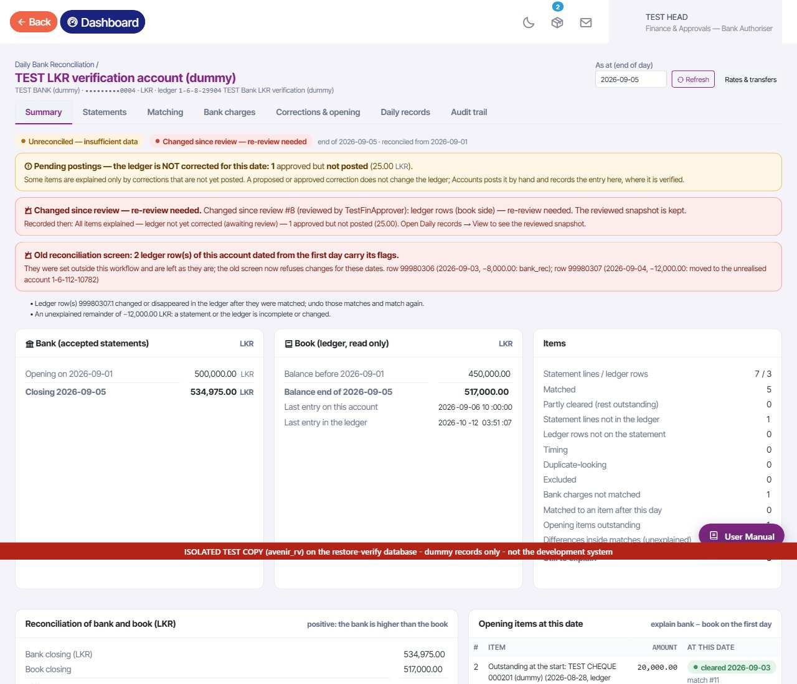

**r3: the overview shows "Old-screen flags in the period: 2".**

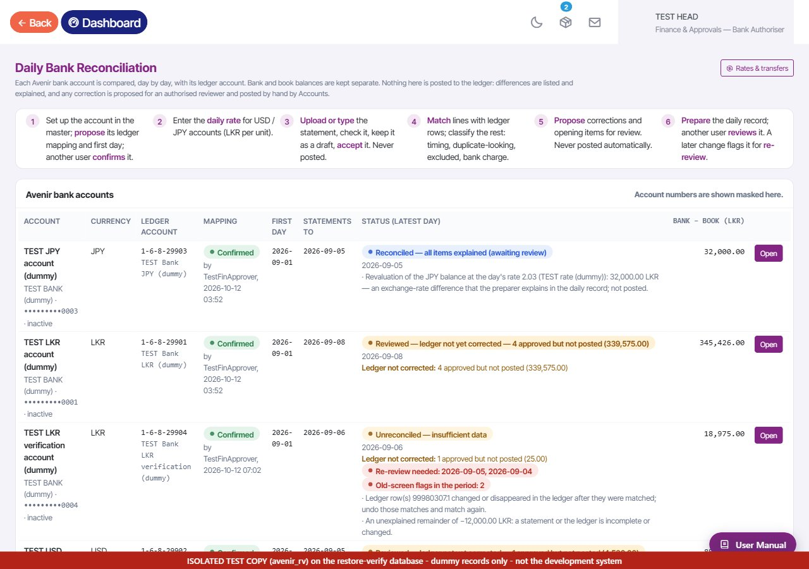

**Dummy posting 99980399 recorded: "Posted — linked to a verified ledger entry".**

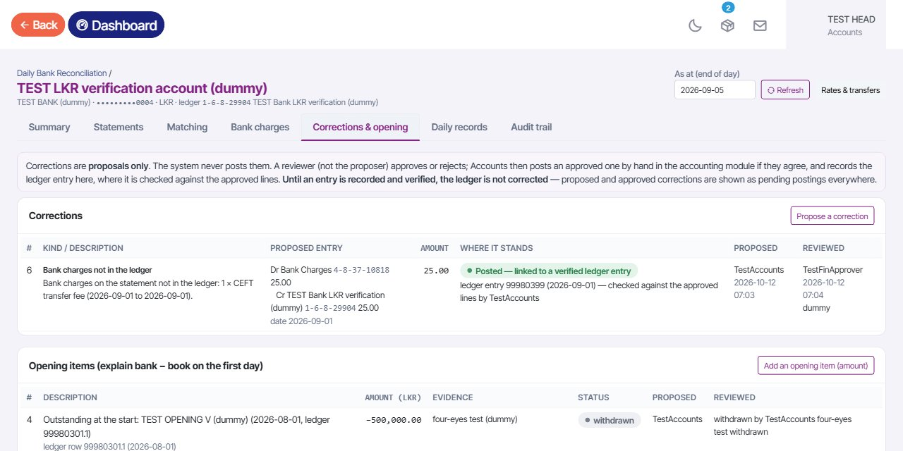

**The entry changed in the ledger: "Posted entry changed in the ledger — verify again" with the Verify again button.**

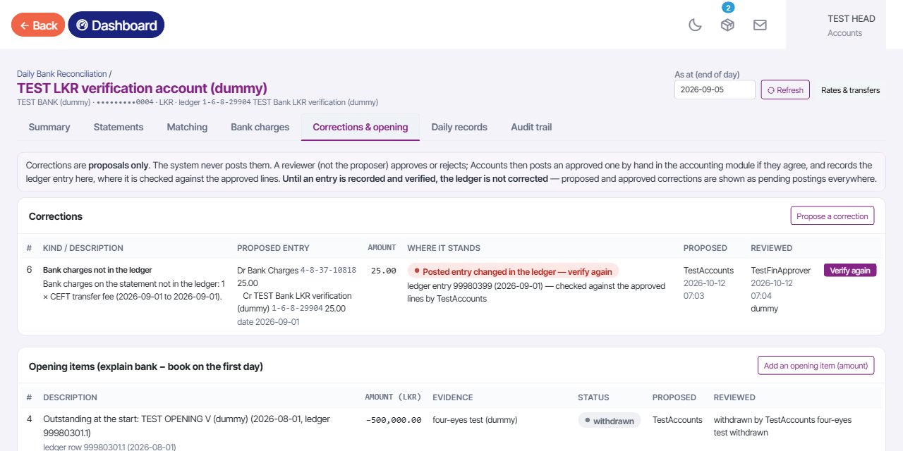

**Amounts changed 25 → 30: verifying again is refused and the differences are listed.**

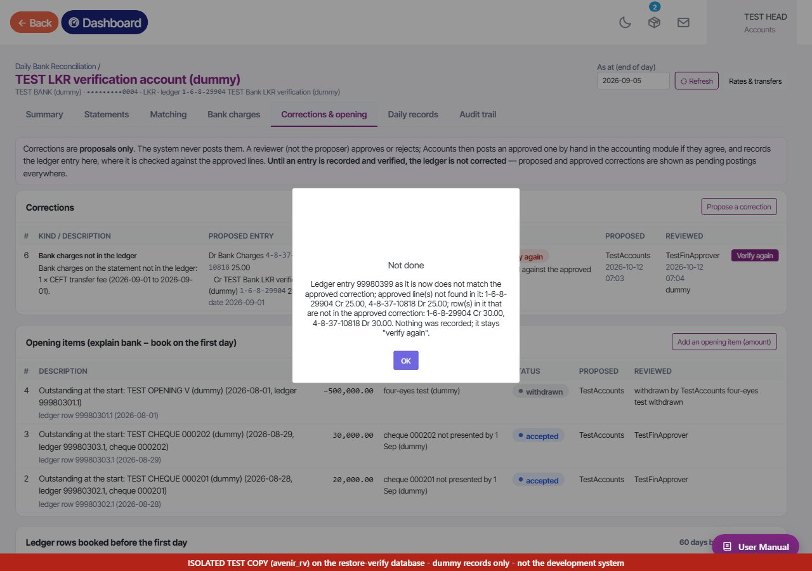

**TestRecDual (preparer + reviewer): their own record has no Review button.**

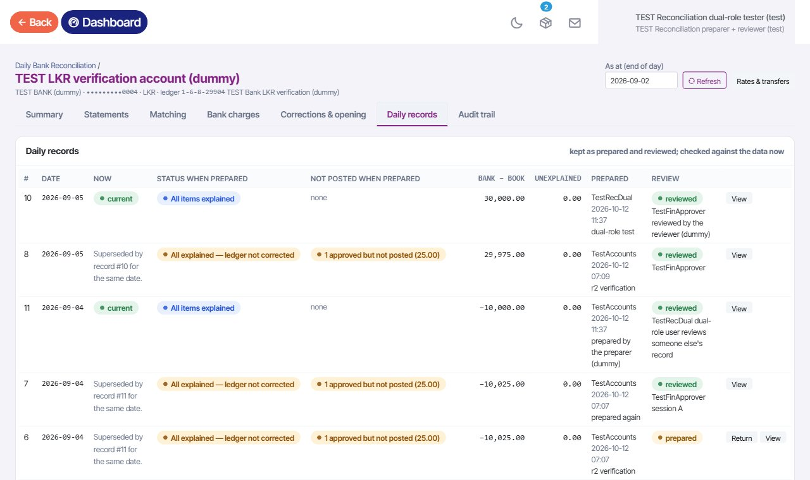

**Forcing the review of their own record: refused by the server.**

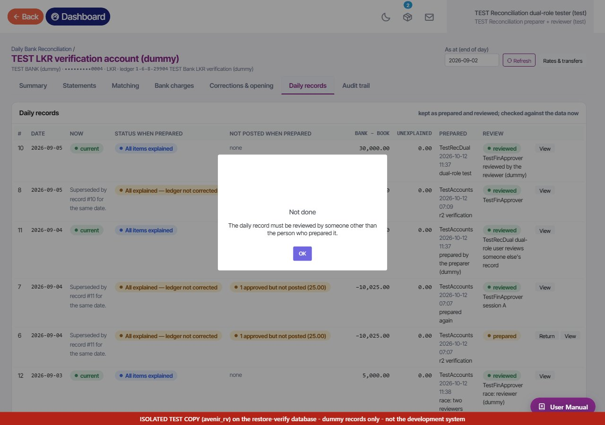

**What TestRecDual withdrew reads "withdrawn by TestRecDual".**

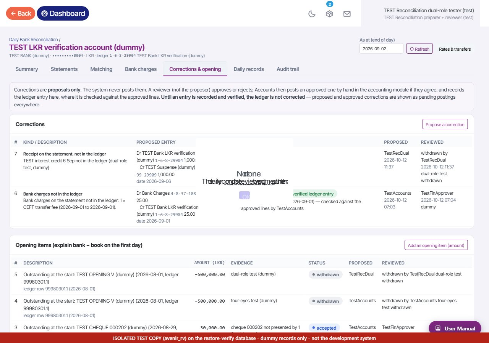

**Sign-out fix (installed on the instance for the test, then rolled back): the notice instead of a blank page.**

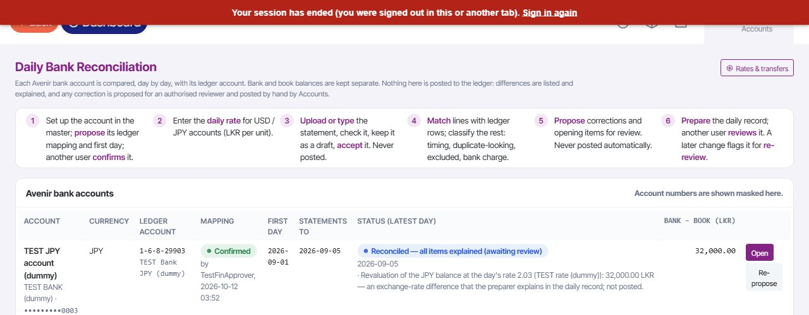

---

## 7. The sign-out fix (your earlier request) — kit `tf-session-r1`, **not installed on development**

**The problem.**

- A page left open keeps asking the server in the background (every 20–30 s).
- After a sign-out, those requests are sent to the sign-in page, and the sign-in page ends the session.
- When such an answer arrives just after a new sign-in, it deletes that sign-in, and the dashboard then goes blank.

**The fix (3 files, no database change):**

- The sign-in page no longer ends a valid session.
- Background requests without a session get a quiet "session ended" answer, with no cookie.
- The page no longer blanks, and shows a red "Your session has ended … Sign in again" notice.

**Tests:**

- **Cloud:** before 14 / 14 problems reproduced; after 18 / 18.
- **Isolated instance:** before, 5 / 5 checks showed the problem (background request sent to the sign-in page, a valid sign-in ended by opening the sign-in page, the blank page). After installing, 6 / 6 passed. **Rolled back afterwards**; the instance's files match the backup except for the r3 files.

**One finding.** Browsers keep the old `plugins.js` in their cache. The notice and the no-blank-page part only take effect after one **Ctrl+F5** per browser (or once the cache expires). The server part — the cause of the lost sign-ins — works at once.

**Option for you:** add a version mark to the script tag (`plugins.js?v=…`) so browsers fetch it at once. That is one more file (`layouts/scripts.php`), and I have not changed it.

**Waiting for your approval** to install the fix on development.

---

## 8. Remaining limitations

1. **The guard depends on confirmed mappings and their first days.** No account is protected until D3/D4 are decided and mappings confirmed.
2. **It guards the old Bank Reconciliation screen only.** Two other old tools touch reconciliation data and are not guarded:
   - Settings → Manual update, "bank_recon_record_insert": a one-off with fixed row IDs from a second database.
   - Accounts → Bank unrealised value: a 2025-03-31 carry-forward.

   I recommend withdrawing both from menus, or guarding them, before live.
3. **Flags already set in a protected period are only reported**, as you asked. Clearing them needs a decision and Accounts' review.
4. **"Verify again" is strict:** a change in the description alone needs a new verification. Accounts may see this after editing narrations.
5. **Amounts up to the day count the items linked to a correction.** A correction linked to no statement line or ledger row is not shown on any day (as in r2).
6. **Still on the old screen (not caused by r3):**
   - its other messages ("Data already exists", "Unexpected error") still do not appear;
   - a date-picker script error;
   - the old menu is still open (D7 step 3: withdraw it after one parallel month — your decision).
7. **The dummy posting was written by SQL.** Recording a real posting made in the accounting module was not tested on real data.
8. **Engines differ.** Cloud tests ran on MariaDB 10.11; the instance runs MySQL 8.4.7 (same results).
9. **Disk space.** The database copy (165 MB) is an extra database on your MySQL. Keep it until the review is done; removing it later is your decision.

---

## 9. Decisions still open (unchanged)

**D1–D7:** D1 off-computer copy of the export; D2 who prepares and who reviews; D3 first day per account; D4 entering the real bank accounts and confirming mappings; D5 statement format; D6 the daily-rate source and exchange-rate policy; **D7** — the guard is now built and tested on the isolated instance, but its use on development/live and the withdrawal of the old menu remain your decision.

**E1–E7:** E1 masking Avenir's paying account; E2 older groups' view of supplier bank numbers; E3 InnoDB conversion; E4 debtor-invoice amendment link; E5 `tour/print`; E6 `LEGACY_ALLOCATION_GROUPS`; E7 the 449,143.20 imbalance and the provisional 34,495,229.47 difference.

**New, for your approval:**

- (a) install r3 on development, with which first days and mappings;
- (b) install the sign-out fix on development, with or without the `plugins.js` version mark;
- (c) what to do with the two unguarded old tools.

---

## 10. Package

**`Claude outputs\tf-bankrec-r3\`**

- `apply.py`, `README.txt`, `SOURCE-MD5.txt`, `src\` (8 + 1 files)
- `sql\`:
  - `backup-before-r3-snapshot.sql`, `before-r3-snapshot\`
  - `reset-to-before-r3.sql`
  - `setup-r3-test-login.sql`
- `tests\`: `test_bankrec_r3.py`, `ui_bankrec_r3.py`, `rv_test_r3.js`, `rehearse_rv_r3.py`, `rehearse_apply_r3.sh`
- `tools\`
- `results\cloud\`, `results\isolated-instance\`
- `before\`: the instance's backups

**`Claude outputs\tf-session-r1\`**

- `apply.py`, `README.txt`, `src\` (3 files)
- `tests\`, `results\`

**Both kits refuse any target other than the isolated instance.** Zips (without the instance's backups): `tf-bankrec-r3-20261012.zip` (md5 09b9b693a1a4b602d0bcd9b01f8b3c25), `tf-session-r1-20261012.zip` (md5 53ce20340448afc977224fc0c993c7ec).
